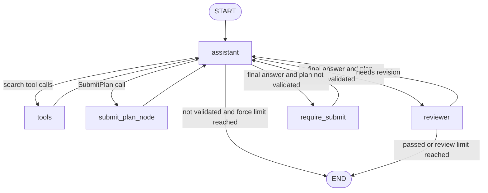

# Travel Agent Bot

A tool-using travel planning agent, built twice with the same design:

1. **From scratch** on the Anthropic API (`agent_bot.py`) — a hand-written agent loop, to understand what an agent actually is.
2. **With LangGraph** (`agent_graph.py`) — the same behaviour expressed as a state graph, to see what a framework does and does not give you.

Both versions combine a deterministic budget check with an LLM reviewer, and use mechanism-level guardrails instead of prompt-only requests.

## Features

- Tool calling with mock hotel and restaurant search, including several parallel tool calls in one turn
- Structured plan submission through a tool schema (`submit_plan` / `SubmitPlan`)
- **Deterministic budget check** — the plan cost is summed and compared with the budget in plain code, not by the LLM
- **LLM reviewer (reflection)** — an independent LLM reviews the plan against explicit, objective criteria and sends it back for revision if it fails
- **Forced validation** — the model cannot show a plan to the user unless it has passed the budget check; `tool_choice` forces a `SubmitPlan` call if the model tries to skip it
- Loop limits for turns, reviews and forced calls, so the agent cannot run forever
- Missing budget handled explicitly instead of guessed
- Final answer formatted as tables, with the remaining budget highlighted

## Architecture (LangGraph version)



- `assistant` — the main model, bound to the search tools and `SubmitPlan`
- `tools` — a `ToolNode` that executes the search tools (in parallel when the model requests several)
- `submit_plan_node` — runs `evaluate_plan` (pure code, not a tool the model can skip) and returns the result as a `ToolMessage`
- `require_submit` — blocks an unvalidated final answer and sets `force_submit`, so the next `assistant` call is made with `tool_choice="SubmitPlan"`
- `reviewer` — an independent LLM with no tools; a failed review sends its comments back to `assistant`

State (`TravelState`) extends `MessagesState` (messages are appended by the `add_messages` reducer) with `review_attempts`, `review_passed`, `budget_validated`, `force_submit` and `force_attempts`.

## Hand-written vs LangGraph

| Concern | Hand-written (`agent_bot.py`) | LangGraph (`agent_graph.py`) |
|---|---|---|
| Tool definition | `name` / `description` / `input_schema` dicts | Plain functions with type hints and docstrings, plus a Pydantic class for the nested `SubmitPlan` schema |
| Running tools | `TOOL_FUNCTIONS` dict + `for` loop | `ToolNode` |
| Agent loop | `while` loop + `stop_reason` checks | Nodes, conditional edges and a `tools -> assistant` loop-back edge |
| Message history | `messages.append(...)` | `MessagesState` with the `add_messages` reducer |
| State | Loose variables (`budget_validated`, `force_submit`, ...) | One `TravelState` object |
| Forcing `SubmitPlan` | Set `force_submit`, then `continue` | A dedicated `require_submit` node, because a routing function can only choose the next node and cannot write state |
| Limits | `max_turns`, `max_reviews` | `recursion_limit`, `MAX_REVIEWS`, `MAX_FORCE` |
| Streaming / tracing | `print` logging | Built-in `stream` and LangSmith / Studio support (not used yet) |

The core ideas (loop, tools, state, validation, guardrails) are the same in both. The framework mostly changes how they are expressed and how visible the flow is.

## Design Decisions

**Why a code-based evaluator instead of an LLM?**
Budget checking is deterministic arithmetic: sum the costs and compare them with the limit. Code does this exactly and repeatably, while an LLM can miscalculate. The subjective question — is the plan reasonable? — is left to the reviewer, since that needs judgment.

**Why force `SubmitPlan` with `tool_choice` instead of asking in the prompt?**
Early on, the model sometimes skipped `submit_plan`, did the arithmetic itself and declared the plan "within budget", bypassing the real check. A prompt is only a request: in testing the model ignored instructions in both directions (skipping the tool when told to call it, and calling it when told not to). So the plan is tracked with a `budget_validated` flag, and if the model tries to finish without a validated plan, the next call is made with `tool_choice` set to the submit tool. The guarantee comes from the mechanism, not the prompt.

**Why put transport and service charges inside the validated schema? (LangGraph version)**
In the first LangGraph version, `SubmitPlan` only had hotels and restaurants. The model added transport and service charges in its prose, so the evaluator approved £305 while the user was shown £365. Adding `transport_cost` and `service_charge` fields to the schema, and summing them in `evaluate_plan`, makes the validated number and the displayed number the same one.

**Why an LLM reviewer with objective criteria?**
The reviewer catches quality problems the budget check cannot, such as a hotel in one area with restaurants 5 miles away. Early versions used vague criteria ("is the plan reasonable?") and the verdict was unstable — the same plan passed on some runs and failed on others. Rewriting the criteria as checkable rules (fail if a restaurant is more than 3 miles from the hotel and no transport is mentioned; fail if the budget omits transport or service charges) made it much more consistent.

**Why cap forced calls as well as reviews?**
A strict reviewer could send the plan back forever, and an infeasible budget could make the agent resubmit a plan that can never pass. Each loop has its own limit (`MAX_REVIEWS`, `MAX_FORCE`, and `recursion_limit` as the outer bound), so the run always ends.

**How are missing inputs handled?**
If the budget is missing, the agent asks the user instead of guessing, and the code reads the budget defensively (`.get()`), so a missing value produces a clear message instead of a crash or a silent default.

## How I tested it

- **Normal request (budget £500):** the plan is submitted, validated, reviewed and returned; the total shown to the user matches the total the evaluator checked.
- **Forced validation path:** I temporarily made `submit_plan_node` never set `budget_validated`. The log showed the "answer blocked" message twice (`MAX_FORCE = 2`), the next call was forced to `SubmitPlan` with no preamble text, and the run then ended cleanly without hitting the recursion limit. The temporary change was reverted afterwards.
- **Infeasible budget (£150):** the model noticed an empty hotel result and retried without the price filter, then resubmitted a smaller plan after the first submission failed. The run ended normally.

## Known limitations

- **The budget check does not cover trip length.** With a £150 budget the agent shrank a 3-day request to one night with no restaurants to pass validation, and said so honestly in its answer. The evaluator only checks cost, so a plan can pass while ignoring other requirements. A fix would add the requested number of nights to the schema and check it as well.
- **The LLM reviewer is not fully consistent.** It sometimes lets through a plan that its own rules would fail (for example a restaurant several miles from the hotel), and different runs can disagree. The location check also relies on the model's own distance estimates.
- **A fallback answer can be unreviewed.** When the review limit or the forced-call limit is reached, the graph ends with the model's last message. There is no fixed "no valid plan found" message, and `review_passed` may be `False`.
- **Mixed tool calls in one turn are not handled.** If the model requests `SubmitPlan` together with a search tool in the same turn, the routing only runs the evaluator, so the search call gets no result. In practice the model searches first and submits afterwards.
- **All data is mock data,** and the reviewer criteria are specific to this toy setup.

## Setup and Run

1. Install dependencies with [uv](https://docs.astral.sh/uv/):
   ```
   uv add anthropic python-dotenv langgraph langchain-anthropic
   ```
2. Put your Anthropic API key in a `.env` file (never commit this file):
   ```
   ANTHROPIC_API_KEY=sk-ant-...
   ```
3. Run either version:
   ```
   uv run python agent_bot.py      # hand-written agent loop
   uv run python agent_graph.py    # LangGraph version
   ```

`list_models.py` is a small utility that prints the Claude models your API key can access.

## Next Steps

- **Real data:** replace the mock hotel and restaurant data with a real API or database.
- **Real distances:** call a maps API so the location check uses measured distances instead of the model's estimates (turning it into a true external-feedback check).
- **Better validation:** check trip length and other user requirements inside the evaluator, not just cost.
- **Evaluation and tracing:** build a small test set with an LLM-as-judge, and add tracing (LangSmith or Langfuse) to measure success rate, cost and latency across runs.
